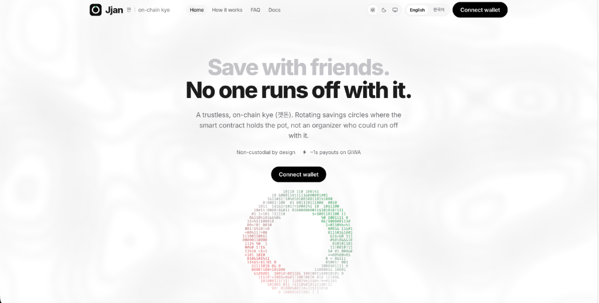

# Jjan (짠) — Trustless On-Chain Savings Circle (Kye)



Korea's _kye_ (곗돈) — informal rotating savings clubs among friends and family — moves billions of won a year on nothing but social trust. However, organizers frequently run off with the pooled funds. 

**Jjan removes the trust.** A non-custodial smart contract escrows every member's contribution and pays the rotating recipient automatically each round. There is no admin key, owner role, or code path that can divert the pot, making the traditional "kye-rug" mathematically impossible.

Built on **GIWA** (Upbit/Dunamu's OP Stack L2) because a club of many small, recurring payments is only viable on a fast, near-free chain.

---

## 🚀 Live Resources

* **🎥 YouTube Demo Video:** https://youtu.be/Ifl9NLPp6L8
* **📖 GitBook Product Documentation:** https://ritesh5969.gitbook.io/jjan-docs/
* **⚡ Live MVP Application:** https://jjan-gamma.vercel.app/

---

## 🛠️ Deployed Contracts (GIWA Sepolia testnet)

All contracts are verified on the block explorer:

| Contract | Address |
|---|---|
| **CircleFactory** | [`0x7f01efFDbEe10d31f300E2b3Fed000C061940551`](https://sepolia-explorer.giwa.io/address/0x7f01efFDbEe10d31f300E2b3Fed000C061940551) |
| **ReputationRegistry** | [`0x0cd53f090471d4aD3f14bEFaC1F60D7F3F076204`](https://sepolia-explorer.giwa.io/address/0x0cd53f090471d4aD3f14bEFaC1F60D7F3F076204) |
| **MockKRW (mKRW)** | [`0x6F82D1b448C3e742e2Da3455611c268C6D72f53B`](https://sepolia-explorer.giwa.io/address/0x6F82D1b448C3e742e2Da3455611c268C6D72f53B) |
| **Circle (Logic implementation)** | [`0xf2b12af647ecf2341960e901e4ee8ba55639377b`](https://sepolia-explorer.giwa.io/address/0xf2b12af647ecf2341960e901e4ee8ba55639377b) |

---

## 🔒 Security Properties (Foundry Tested)

- **No Custodial Drain:** Funds leave the contract only via `closeRound` (to the round's fixed recipient) or `withdrawBond` (to the member). There is no owner/admin transfer path.
- **Solvency Invariant:** `balanceOf(circle) >= obligations()` (i.e. `totalBonds + escrowedPot`) is strictly maintained across 128,000 randomized state-machine call sequences via Foundry handler-driven invariant tests.
- **Reentrancy Prevention:** Every fund-moving function uses `nonReentrant` modifiers and follows the checks-effects-interactions pattern with pull-payments for bond withdrawals.
- **Input Hardening:** Initialize checks reject duplicate member addresses, zero addresses, and configurations with fewer than 2 participants.

---

## 💻 Development & Testing

Built with Foundry and Next.js.

### Smart Contracts:
```bash
# Build contracts
forge build

# Run unit, fuzz, and invariant tests
forge test -vvv          # 9 tests pass green

# Code formatting
forge fmt
```

### Web Frontend:
```bash
cd web
npm install
npm run dev   # launches local dev server at http://localhost:3005
```

---

## 🏆 GASOK Submission Details

* **Project:** Jjan (짠)
* **Accelerator:** GASOK (GIWA × Upbit) MVP Build Phase
* **Tracks:** Consumer/Social · Mass Adoption · GIWA-Native
* **Developer:** Ritesh ([@Ritesh5969](https://x.com/Ritesh5969))
