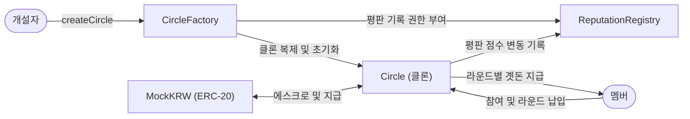

# 아키텍처

Jjan은 각각의 역할에 특화된 3개의 소형 스마트 컨트랙트와 테스트넷용 스테이블코인으로 구성됩니다. 단 하나의 원형 `Circle` 로직 컨트랙트가 배포되어 있으며, 이후 생성되는 모든 개별 곗방은 가스비가 저렴한 **EIP-1167 미니멀 프록시 클론(Clone)** 형태로 복제 및 배포됩니다.

## 시스템 개요

## 컨트랙트 상세 역할

| 컨트랙트 | 핵심 역할 |
| --- | --- |
| **`CircleFactory`** | 원본 `Circle` 스마트 컨트랙트를 기반으로 EIP-1167 클론을 복제 배포하고, 해당 클론에 지갑 평판 점수 기록 권한을 부여합니다. 또한 배포된 모든 곗방의 인덱스를 관리합니다. |
| **`Circle`** | 개별 계모임별 에스크로 및 순환 정산 상태 머신입니다. 스테이블코인을 예치하고 가입, 납입, 보증금 삭감(Slashing), 곗돈 수령, 보증금 출금 등의 약정된 모든 비즈니스 로직을 강제합니다. |
| **`ReputationRegistry`** | 각 개인지갑별 온체인 평판 점수를 기록하는 전역 컨트랙트입니다. 오직 팩토리(Factory)로부터 승인받은 정상 곗방 컨트랙트(Circle)만 평판 점수를 변경할 수 있으므로 임의 위변조가 불가능합니다. |
| **`MockKRW`** | 테스트넷 전용 KRW 스테이블코인으로 자유롭게 충전할 수 있는 수도꼭지(Faucet)가 내장되어 있어 납입금과 보증금 지불에 사용됩니다. 메인넷 배포 시에는 실제 1:1 보증 또는 공식 브릿지된 원화 스테이블코인으로 대체됩니다. |

## 클론(EIP-1167)을 사용하는 이유

실제 상용 서비스 단계에서는 수천 개의 개별 곗방이 개설됩니다. 매번 완전히 새로운 컨트랙트 전체 바이트코드를 배포하는 방식은 불필요하게 가스비를 낭비하게 됩니다. 이를 해결하기 위해:

* 핵심 비즈니스 로직이 담긴 `Circle` 컨트랙트(Implementation)는 단 한 번만 배포됩니다.
* 새로이 개설되는 모든 곗방은 원본 로직을 대리 실행(Delegatecall)하는 **미니멀 프록시**(EIP-1167) 컨트랙트 형태로 배포되어 배포 가스비를 획기적으로 낮춥니다.
* 프록시 클론은 배포 시 Solidity 생성자(Constructor)를 실행할 수 없으므로, 일회성 초기화 함수인 `initialize()` 함수를 사용하여 곗방 설정을 완료하며, 이 함수는 `initialized` 플래그를 통해 재실행이 철저히 차단됩니다.

## 팩토리 ↔ 평판 레지스트리 상호 의존성 해결

`ReputationRegistry`는 어떤 주소가 공식 `CircleFactory`인지 인지해야 권한을 가진 컨트랙트만 평판 쓰기 권한을 주도록 제한할 수 있으며, `CircleFactory` 또한 평판을 기록할 대상 레지스트리 주소를 알아야 합니다. 

배포 시 두 주소를 모두 수정 불가능한 `immutable` 변수로 선언하고 안전하게 결합하기 위해, 배포 스크립트 상에서 `vm.computeCreateAddress`를 사용하여 **팩토리가 배포될 주소를 사전에 계산(Precompute)**해 레지스트리 생성자 인자로 전달하고, 이후 해당 주소에 실제 팩토리를 배포하여 오차 없이 의존성을 해결합니다. 자세한 절차는 [배포 가이드](../deployment/deploy-guide.md)를 참고하세요.
