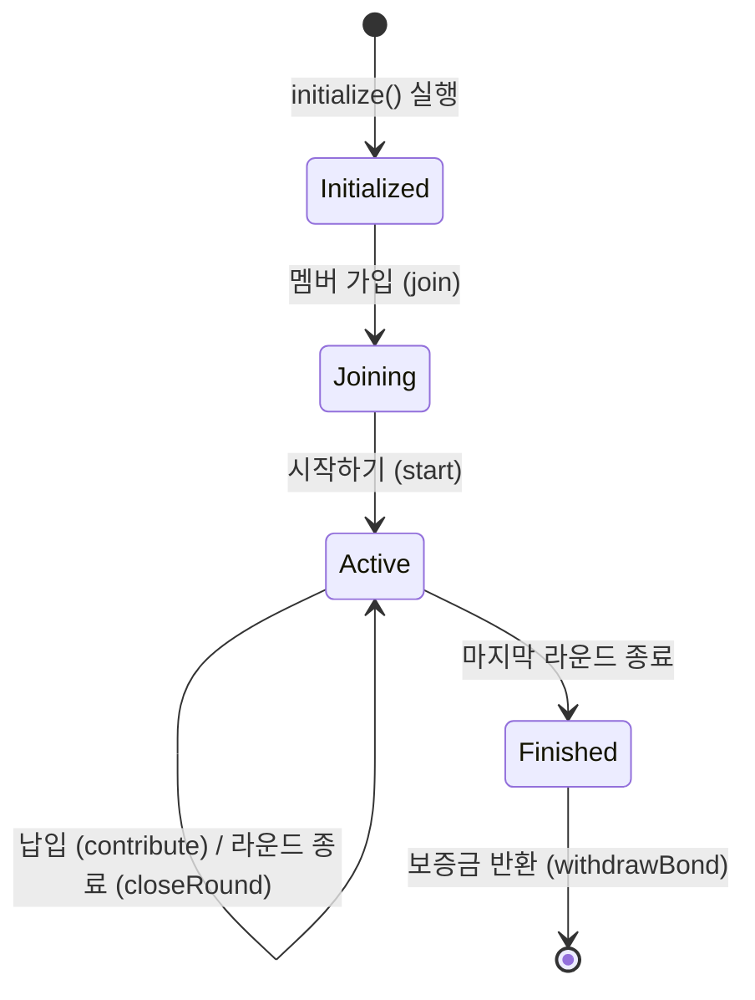

# Circle 스마트 컨트랙트

`Circle` 컨트랙트는 Jjan의 심장부에 해당합니다. 설정 단계부터 모든 순환 정산 라운드를 거쳐 종료될 때까지 모임 전체를 주관하는 순환식 에스크로 상태 머신입니다. 클론(Clone) 형태로 배포되기 때문에 생성자 대신 `initialize()` 함수를 통해 최초 설정을 1회 정의합니다.

## 라이프사이클 (생명주기)

## 핵심 함수 설명

| 함수명 | 호출 주체 | 핵심 동작 |
| --- | --- | --- |
| `initialize(...)` | 팩토리 (최초 1회) | 토큰 주소, 라운드당 납입액, 라운드 진행 시간, 예치 보증금, 평판 기록 레지스트리 주소 및 고정 수령 순서(Payout Order)를 설정합니다. 중복되거나 잘못된 주소, 2인 미만의 곗방 개설 시도를 거부합니다. |
| `join()` | 초대된 곗방 멤버 | 약정된 보증금을 납입하고 곗방에 가입합니다. 오직 최초 설정된 수령 순서 명단에 포함된 주소만 가입할 수 있습니다. |
| `start()` | 제한 없음 | 라운드 1을 시작합니다. **모든** 초대된 멤버가 가입을 완료하고 보증금을 입금한 경우에만 실행할 수 있습니다. |
| `contribute()` | 곗방 멤버 | 현재 진행 중인 라운드의 고정 납입액을 에스크로 계좌로 입금합니다. |
| `closeRound()` | 제한 없음 (라운드 시간 종료 후) | 이번 라운드에 미납한 멤버의 보증금을 삭감하여 곗돈 풀에 충당하고, 약정된 수령자에게 곗돈 총액을 송금한 뒤, 다음 라운드로 상태를 전환(또는 계 종료)합니다. |
| `withdrawBond()` | 곗방 멤버 | 전체 라운드가 종료된 뒤, 삭감되지 않고 남아 있는 자신의 보증금 잔액을 출금합니다. |

## 라운드 진행, 지급 및 보증금 삭감 (Slashing)

* **고정된 수령자:** 수령 순서인 `payoutOrder`는 개설 단계에서 결정됩니다. 라운드 $n$의 곗돈은 항상 `payoutOrder[n]` 주소로 송금됩니다. 수령자는 완전히 결정론적이며 호출자가 임의로 지정하거나 변경할 수 없습니다.
* **곗돈 총액:** 매 라운드 수령자가 받는 곗돈은 해당 라운드에 멤버들이 제때 납입한 정규 납입금과, 미납자의 보증금에서 삭감된 금액의 합계로 구성됩니다.
* **보증금 삭감 (Slashing):** 라운드 기간 내에 납입하지 않은 멤버는 예치한 보증금에서 최대 1회분 납입액만큼 삭감되어 곗돈 풀로 강제 이체됩니다. 이 메커니즘을 통해 일부 인원의 체납이 발생하더라도 곗방의 총 지급액은 온전하게 보장되며, 연체자가 발생해도 `closeRound()`는 차질 없이 집행되므로 곗방 자체가 마비되지 않습니다.
* **평판 반영:** 매 라운드가 마감될 때마다, 정상 납입한 멤버는 `+1` 점, 연체하거나 미납한 멤버는 `-1` 점의 평판 변동 내역이 [`ReputationRegistry`](architecture.md) 컨트랙트에 영구 기록됩니다.

## 장부 회계 상태 관리

`Circle` 컨트랙트는 곗방이 멤버들에게 빚지고 있는 총 부채 금액을 정확히 추적하기 위해 두 가지 상태 변수를 관리합니다.

* `totalBonds` — 현재 보관 중인 모든 멤버의 유효한 보증금 합계.
* `escrowedPot` — 현재 라운드 동안 모였으나 아직 수령자에게 지급되지 않은 납입금 및 삭감액의 합계.

공개 뷰(View) 함수인 `obligations()`는 `totalBonds + escrowedPot`을 계산하여 반환합니다. 이는 Jjan 보안 모델의 핵심인 [자산 실존성 인바리언트](security-model.md#지급-준비성-일치-인바리언트-solvency-invariant)의 기본 평가지표가 됩니다. 즉, 컨트랙트가 보유한 토큰 잔액은 항상 이 부채 총액(`obligations`)보다 크거나 같아야 합니다.
