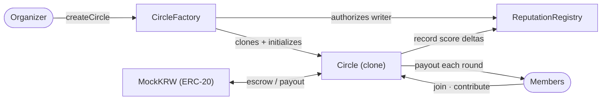

# Architecture

Jjan is three small, focused contracts plus a testnet stablecoin. One `Circle`
implementation is deployed once; every savings club is a cheap **EIP-1167 clone**
of it.

## System overview

## The contracts

| Contract | Responsibility |
| --- | --- |
| **`CircleFactory`** | Deploys each circle as an EIP-1167 clone of the `Circle` implementation and authorizes it to write reputation. Indexes all circles. |
| **`Circle`** | The per-club escrow and rotation state machine. Holds the stablecoin and enforces every rule: joins, contributions, slashing, payouts, bond withdrawal. |
| **`ReputationRegistry`** | A single global contract holding a per-wallet reliability score. Only factory-authorized circles may write deltas; nobody can forge a score. |
| **`MockKRW`** | A testnet-only KRW stablecoin with an open faucet, used for contributions and bonds. A real bridged/canonical stablecoin replaces it on mainnet. |

## Why clones

A production deployment will have thousands of circles. Deploying a full contract
per circle would be wasteful. Instead:

* The `Circle` **logic** is deployed exactly once (the "implementation").
* Each new circle is a **minimal proxy** (EIP-1167) that delegates to that logic,
  costing a small fraction of a full deployment.
* Because clones do not run constructors, `Circle` is configured through a one-shot
  `initialize()` guarded by an `initialized` flag.

## Resolving the factory ↔ registry dependency

The `ReputationRegistry` needs to know the factory address (only the factory may
authorize writers), and the factory needs the registry address. To keep both
immutable, deployment **precomputes** the factory's address with
`vm.computeCreateAddress` and passes it to the registry constructor, then deploys
the factory — asserting the real address matches the prediction. See
[Deploy it yourself](../deployment/deploy-guide.md).
