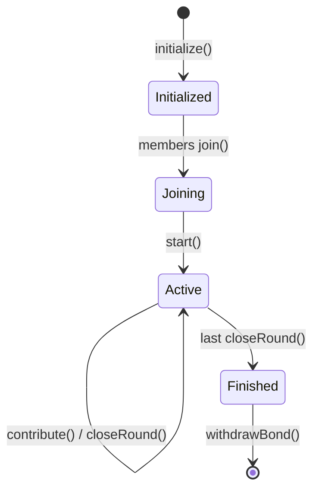

# The Circle contract

`Circle` is the heart of Jjan: a rotating-escrow state machine that takes a club
from setup through every round to completion. It is deployed as a clone, so its
configuration is set once via `initialize()` rather than a constructor.

## Lifecycle

## Key functions

| Function | Who | What it does |
| --- | --- | --- |
| `initialize(...)` | Factory (once) | Sets token, contribution, round duration, bond, reputation, and the fixed payout order. Rejects duplicate/zero members and circles with fewer than two members. |
| `join()` | Invited member | Posts the required bond and joins. Only addresses in the payout order may join. |
| `start()` | Anyone | Opens round 1 — but only once **every** invited member has joined. |
| `contribute()` | Member | Pays the fixed contribution for the current round into escrow. |
| `closeRound()` | Anyone (after the window) | Slashes members who missed this round, pays the round's fixed recipient, and advances to the next round (or finishes). |
| `withdrawBond()` | Member | After the circle finishes, returns any bond still standing. |

## Rounds, payouts, and slashing

* **Fixed recipient.** `payoutOrder` is set at creation. Round _n_ always pays
  `payoutOrder[n]` — the recipient is deterministic and never chosen by the caller.
* **The pot.** Each round's pot is the sum of that round's contributions plus any
  slashes, paid in full to the recipient.
* **Slashing.** A member who fails to contribute in a round has up to one
  contribution's worth taken from their posted bond and added to the pot. This
  keeps the circle solvent and honest members whole, and no-shows cannot stall the
  club — `closeRound()` proceeds regardless.
* **Reputation.** On each close, paying members get a `+1` and no-shows a `-1`
  written to the [`ReputationRegistry`](architecture.md).

## Accounting state

`Circle` tracks two buckets that together represent everything it owes:

* `totalBonds` — the sum of live bonds it still holds for members.
* `escrowedPot` — contributions and slashes collected but not yet paid out.

The public view `obligations()` returns `totalBonds + escrowedPot`. This is the
basis of the [solvency invariant](security-model.md#the-solvency-invariant): the
contract's token balance must always be at least its obligations.
